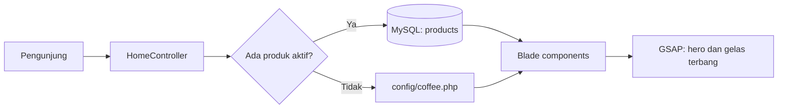

<div align="center">

# ☕ Coffee & Co.

**Jeda kecil. Rasa yang tinggal.**

Website kedai kopi dengan animasi GSAP, menu yang dikelola dari database,
dan pemesanan langsung lewat WhatsApp.

[🌐 Lihat Website](https://coffeeco.gamer.gd) · [✨ Fitur](#-fitur) · [🚀 Instalasi](#-instalasi-lokal) · [🔐 Panel Admin](#-panel-admin)

<br>


</div>

---

## ✨ Fitur

| 🛍️ Website publik | 🔐 Panel admin |
| --- | --- |
| Hero carousel 4 produk dengan animasi GSAP | Login admin dengan pembatasan percobaan |
| Menu 8 produk langsung dari database | Dashboard pengelolaan |
| Tombol **Order via WhatsApp** dengan pesan otomatis | CRUD kategori dan produk |
| Efek **gelas terbang** saat scroll ke section Favorit | Upload foto produk (JPG, PNG, WebP) |
| Navbar dengan tombol Login dan **menu hamburger** di HP | Atur label, warna latar kartu, urutan, dan status produk |
| Tampilan responsif dari desktop sampai HP | Validasi dengan pesan berbahasa Indonesia |

Beberapa detail kecil:

- Jumlah produk di teks ("8 RASA, SATU RITUAL.") ikut berubah otomatis mengikuti produk aktif.
- Kalau database belum siap, menu memakai daftar cadangan di `config/coffee.php`, jadi halaman tidak error.
- Animasi dimatikan untuk pengunjung yang memilih *reduced motion*.

<!--
## 🎬 Tampilan

Letakkan screenshot di folder `docs/` lalu hapus tanda komentar ini:

<p align="center">
  
  
</p>
<p align="center">
  
  
</p>
-->

## 🧰 Teknologi

| Bagian | Yang dipakai |
| --- | --- |
| Backend | Laravel 12, PHP 8.2 |
| Tampilan | Blade components, CSS biasa |
| Animasi | GSAP 3.12.5 |
| Database | MySQL / MariaDB |
| Font | Anton dan Inter |
| Hosting | InfinityFree |

## 🗺️ Alur data menu



## 🚀 Instalasi lokal

Syarat: PHP 8.2+, Composer, dan MySQL/MariaDB (misalnya lewat XAMPP).

**1. Unduh project dan pasang paket**

```bash
git clone https://github.com/risma11-cpu/coffeeco.git
cd coffeeco
composer install
```

**2. Siapkan file `.env`**

```bash
cp .env.example .env        # Windows PowerShell: copy .env.example .env
php artisan key:generate
```

**3. Buat database kosong** bernama `coffee_co` di phpMyAdmin (collation `utf8mb4_unicode_ci`), lalu atur `.env`:

```dotenv
DB_CONNECTION=mysql
DB_HOST=127.0.0.1
DB_PORT=3306
DB_DATABASE=coffee_co
DB_USERNAME=root
DB_PASSWORD=

AUTH_MODEL=App\Models\Admin
COFFEE_WHATSAPP=6281234567890

ADMIN_NAME="Admin Coffee & Co."
ADMIN_EMAIL=admin@example.com
ADMIN_PASSWORD=isi-password-yang-kuat
```

**4. Bangun tabel, isi data awal, lalu jalankan**

```bash
php artisan migrate
php artisan db:seed
php artisan serve
```

Buka <http://localhost:8000>. Setelah seeder berhasil, kosongkan `ADMIN_PASSWORD` di `.env`.

## 🔐 Panel admin

- Masuk lewat tombol **Login** di navbar atau alamat `/admin/login`.
- Gunakan `ADMIN_EMAIL` dan `ADMIN_PASSWORD` dari `.env` saat seeder dijalankan.
- Foto yang diunggah disimpan di `public/uploads/products`. Pakai PNG atau WebP berlatar transparan agar kartu tampil rapi.

## 📁 Struktur folder

```text
app/
  Http/Controllers/        HomeController dan Admin/ (Auth, Dashboard, Category, Product)
  Models/                  Product, Category, Admin
config/coffee.php          isi hero, menu cadangan, dan section Favorit
database/
  migrations/              admins, categories, products
  seeders/                 AdminSeeder, ProductSeeder
public/
  css/  js/  assets/       gaya, skrip GSAP, dan foto produk
resources/views/
  components/              navbar, mobile-nav, hero, menu, favorite, dan lainnya
  admin/                   halaman panel admin
routes/web.php
```

## 🌐 Deployment (InfinityFree)

InfinityFree tidak punya SSH, jadi database dipindahkan lewat ekspor dan impor SQL:

1. Jalankan `composer install --no-dev --optimize-autoloader` pada salinan project.
2. Ekspor database lokal dari phpMyAdmin, lalu impor ke database hosting.
3. Isi folder `public` diunggah ke `htdocs`. Sisa project diunggah ke `htdocs/laravel`.
4. Ubah jalur di `htdocs/index.php` agar menunjuk ke folder `laravel`.
5. Buat `.env` produksi (`APP_ENV=production`, `APP_DEBUG=false`, `SESSION_DRIVER=file`, `CACHE_STORE=file`, dan koneksi MySQL hosting).
6. Kunci folder `laravel` dengan `.htaccess` berisi `Require all denied`.

## 🛣️ Rencana pengembangan

- [x] Hero carousel, menu, dan section Favorit
- [x] Menu dari database dengan migration dan seeder
- [x] Panel admin untuk kategori dan produk
- [x] Navbar responsif dengan hamburger
- [x] Tayang di hosting
- [ ] Domain sendiri
- [ ] Pengaturan foto kartu produk baru langsung dari admin
- [ ] Rekap pesanan

## 📄 Lisensi

Dirilis dengan lisensi [MIT](https://opensource.org/licenses/MIT).

---

<div align="center">
Dibuat dengan ☕ dan Laravel
</div>
